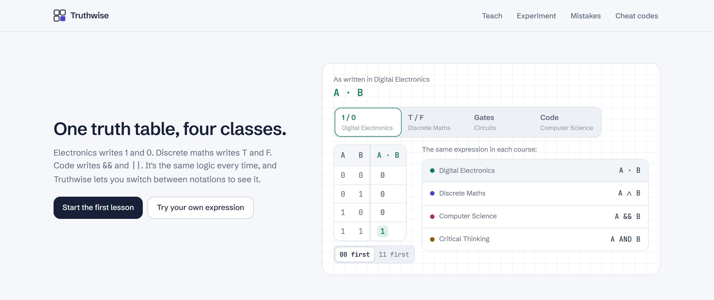
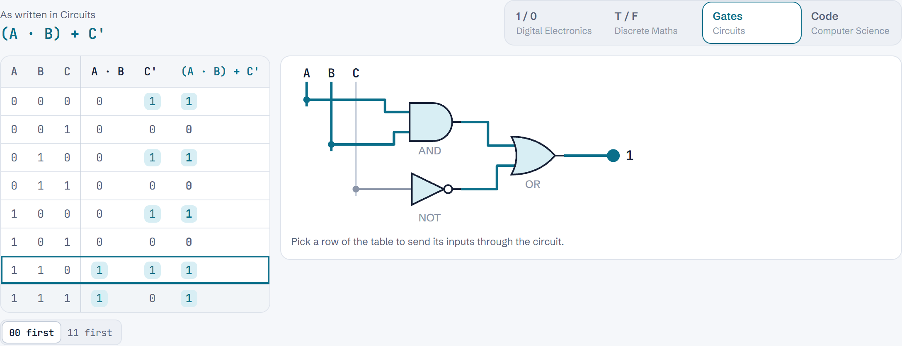
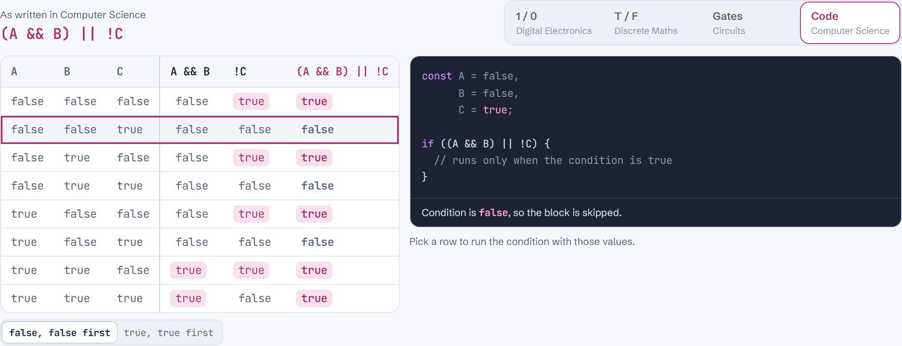
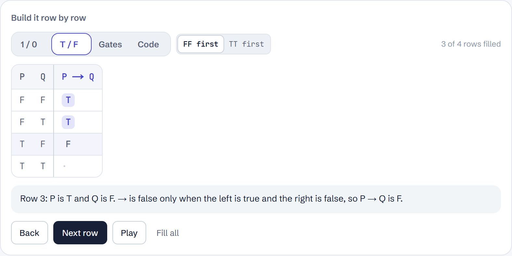
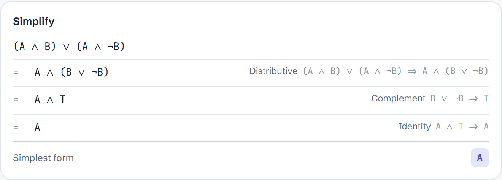
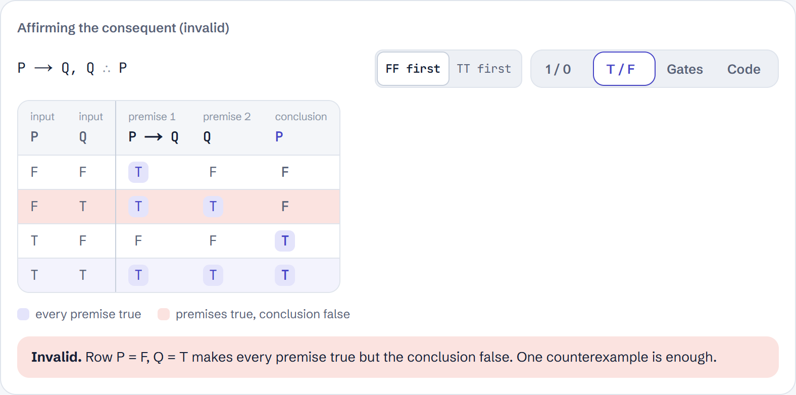
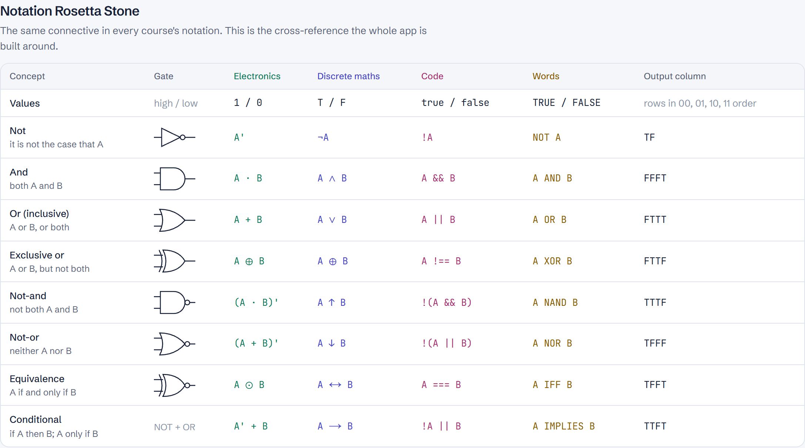
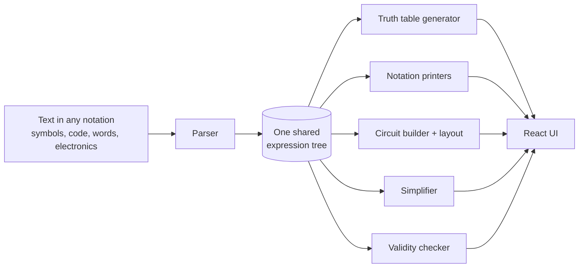
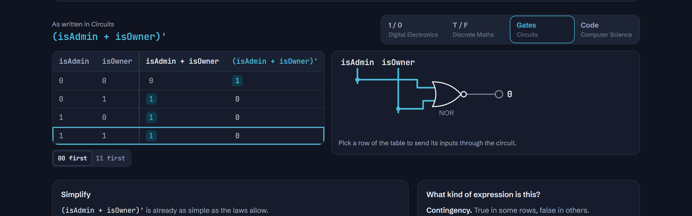

<div align="center">


# Truthwise

**One truth table, four classes.**

An interactive way to learn Boolean logic and truth tables. It shows that Digital Electronics,
Discrete Maths, Critical Thinking and programming all teach the _same_ logic, written four different ways.

[**Open the live app →**](https://truthwise.vercel.app)

[](https://truthwise.vercel.app)




</div>

---

## Contents

- [Why Truthwise exists](#why-truthwise-exists)
- [Features](#features)
- [The notation toggle](#the-notation-toggle)
- [The four modes](#the-four-modes)
- [Supported notation](#supported-notation)
- [How it works](#how-it-works)
- [Testing](#testing)
- [Getting started](#getting-started)
- [Deploying](#deploying)
- [Project structure](#project-structure)
- [Design notes](#design-notes)
- [Part of a series](#part-of-a-series)

---

## Why Truthwise exists

Truth tables turn up in at least four courses, and each one teaches them as if they were new:

| Course | Writes "A and B" as | Values | Draws it as |
|---|---|---|---|
| **Digital Electronics** | `A · B` | `1` / `0` | an AND gate |
| **Discrete Maths** | `P ∧ Q` | `T` / `F` | a truth table |
| **Critical Thinking** | "P and Q" | true / false | an argument |
| **Computer Science** | `a && b` | `true` / `false` | an `if` condition |

Nobody tells students these are the same four rows. Truthwise makes that connection the centre of the app: **every table can be switched between all four notations**, so a student can see "oh, this is the thing from my other class."

## Features

- **Notation toggle on every table:** 1/0, T/F, gate diagram or code, with an animated transition rather than an instant swap.
- **Live gate circuits:** expressions become real logic-gate diagrams. Pick a row and the wires carrying a 1 light up.
- **Row-by-row building:** tables fill in one row at a time, with a sentence explaining each result.
- **Step-by-step simplification:** each step names the law it uses (De Morgan, absorption, distributive…).
- **Argument validity checker:** shows the rows where every premise is true and highlights any counterexample.
- **Write in any notation:** `A AND NOT B`, `a && !b`, `A · B'` and `P ∧ ¬Q` all work, and you can mix them.
- **Row-order switch:** list rows the electronics way (00 first) or the textbook way (TT first). The rows slide into place.
- **Progress saved in the browser:** completed lessons and solved exercises are remembered. Nothing is locked and there's no sign-up.
- **Dark mode** that follows your system setting, plus full support for phones, the keyboard and reduced motion.

## The notation toggle

The same expression, `(A ∧ B) ∨ ¬C`, in two of its four views. The table never changes. Only the way it's written does.

<table>
<tr>
<td width="50%"></td>
<td width="50%"></td>
</tr>
<tr>
<td align="center"><sub><b>Gates:</b> pick a row and the signal flows through the circuit</sub></td>
<td align="center"><sub><b>Code:</b> pick a row and the <code>if</code> runs with those values</sub></td>
</tr>
</table>

## The four modes

### 1. Teach

Six modules and 17 lessons. Each module is written in the language of one course, and each ends with a **notation bridge** that shows the module's main idea in all four notations.

| # | Module | Framing | Covers |
|---|---|---|---|
| 1 | What is a truth table? | Every course | Boolean values, 2ⁿ rows, AND / OR / NOT, the first notation bridge |
| 2 | Logic gates | Digital Electronics | AND, OR, NOT, NAND, NOR, XOR, XNOR, universal gates, half adder |
| 3 | Propositional logic | Discrete Maths | →, ↔, converse and contrapositive, tautologies, equivalence |
| 4 | Boolean algebra | Electronics + Maths | De Morgan, absorption, distributive and identity laws, simplifying |
| 5 | Arguments & validity | Critical Thinking | Modus ponens and tollens, syllogisms, fallacies that feel valid |
| 6 | Boolean logic in code | Computer Science | `&&` `\|\|` `!`, precedence, short-circuiting, truthy/falsy, De Morgan refactors |

Every lesson ends with **Try it yourself** exercises: fill in a table, match a table to its gate, write an expression with a given table, or decide whether an argument is valid. Answers are checked by the logic engine, so any equivalent answer is accepted.



### 2. Experiment

A sandbox. Type any expression in any notation and see its truth table, gate circuit, `if` statement, simplest form and classification (tautology, contradiction or contingency), all updating as you type. Mistakes in the expression are pointed out at the exact character.



### 3. Learn from mistakes

Seven errors that catch almost everyone. Each shows the tempting reasoning, the truth table that disproves it, and the correct version:

- When "and" in English means OR
- De Morgan without the flip
- Necessary vs sufficient (→ backwards)
- Affirming the consequent and denying the antecedent
- Missing a row in a 3-variable table
- Confusing XOR with OR
- Operator precedence



### 4. Cheat codes

A searchable reference: all 7 gates with symbols and tables, 21 laws and identities, 11 argument forms (valid ones and their invalid look-alikes), and a **notation Rosetta Stone** cross-referencing every connective across courses. You can search by name or by symbol: `&&` finds AND and `nand` finds ↑.



## Supported notation

Notations can be mixed freely in one expression.

| Meaning | Symbolic | Code | Words | Electronics |
|---|---|---|---|---|
| NOT | `¬A` `~A` | `!a` | `NOT A` | `A'` |
| AND | `A ∧ B` | `a && b` `a & b` | `A AND B` | `A · B` `A * B` |
| OR | `A ∨ B` | `a \|\| b` `a \| b` | `A OR B` | `A + B` |
| XOR | `A ⊕ B` | `a != b` `a ^ b` | `A XOR B` | `A ⊕ B` |
| NAND / NOR | `A ↑ B` / `A ↓ B` | | `A NAND B` / `A NOR B` | |
| XNOR | `A ⊙ B` | | `A XNOR B` | `A ⊙ B` |
| Implies | `A → B` `A ⇒ B` | `a -> b` `a => b` | `A IMPLIES B` | |
| If and only if | `A ↔ B` `A ≡ B` | `a == b` `a <-> b` | `A IFF B` | |
| True / False | `T` `⊤` / `F` `⊥` | `true` / `false` | `TRUE` / `FALSE` | `1` / `0` |

**Precedence**, from tightest: `NOT`, then code equality `==` `!=`, then `AND`, `XOR`, `OR`, `→`, `↔`. `→` groups to the right. `==` binds tighter than `&&`, as it does in JavaScript and C, so `a == b && c` means `(a == b) && c`. Variables can be single letters or full names such as `isAdmin` or `x1`.

## How it works

Everything runs in the browser. There is no backend, no account and no database.



The core is a standalone TypeScript **logic engine** in [`src/lib/logic`](src/lib/logic), written and tested before any UI:

| Module | What it does |
|---|---|
| [`parser.ts`](src/lib/logic/parser.ts) | Reads all four notations into one shared expression tree, with friendly errors that point at the problem |
| [`truth-table.ts`](src/lib/logic/truth-table.ts) | Generates every row in either order, with intermediate "working" columns and tautology/contradiction classification |
| [`format.ts`](src/lib/logic/format.ts) | Prints any expression in any notation using that notation's own precedence rules. Operators a notation lacks are rewritten, so `→` in code becomes `!a \|\| b` |
| [`circuit.ts`](src/lib/logic/circuit.ts) | Turns expressions into gate circuits (merging NOT+AND into NAND, and so on) and lays them out with input rails |
| [`simplify.ts`](src/lib/logic/simplify.ts) | Applies named laws one step at a time. Expands →, ↔ and ⊕ only when that makes the result smaller |
| [`minimize.ts`](src/lib/logic/minimize.ts) | Quine–McCluskey minimisation, a clearly labelled fallback when the classroom laws stop short of the minimum |
| [`argument.ts`](src/lib/logic/argument.ts) | Builds an argument's combined truth table and finds counterexamples |
| [`laws.ts`](src/lib/logic/laws.ts) | The catalogue of laws shown in Cheat Codes and used to name simplification steps |

**Tech stack:** Next.js 16 (App Router, static pages) · React 19 · TypeScript (strict) · Tailwind CSS 4 · Motion · Zustand · Vitest · Playwright.

## Testing

Correctness matters more here than anywhere else in the app, because it teaches people the rules of logic.

```bash
npm test           # 451 unit tests (Vitest)
npm run test:e2e   # 84 end-to-end checks (Playwright, desktop + phone)
```

The unit tests go beyond spot checks:

- **Every law in the catalogue is proven** by comparing truth tables, so the cheat sheet can't teach something false.
- **Every simplification step** is checked to keep the truth table the same, across a set of awkward inputs.
- **All 16 two-variable functions** simplify to their true minimum.
- **Every notation round-trips:** printing and re-parsing gives an equivalent expression in all four notations.
- **Lesson content is tested like code:** every expression parses, every answer key agrees with the engine, every argument labelled valid really is valid, and every "wrong" example in Mistakes really is wrong.

The end-to-end tests load all 29 pages at desktop and phone sizes and fail on any console error or sideways scrolling. They also click through the real flows: the toggle (including by keyboard), the sandbox, exercises, progress surviving a reload, validity, search and dark mode.

## Getting started

You need **Node.js 20+** and npm.

```bash
git clone https://github.com/ohenemanaf/TRUTHWISE.git
cd TRUTHWISE
npm install
npm run dev
```

Open <http://localhost:3000>.

| Script | What it does |
|---|---|
| `npm run dev` | Development server |
| `npm run build` | Production build |
| `npm start` | Serve the production build |
| `npm test` | Unit tests |
| `npm run test:e2e` | Build, start on port 3123, then run the Playwright tests |
| `npm run lint` | ESLint |

> **Note on end-to-end tests:** they use the locally installed Microsoft Edge (`channel: "msedge"` in [`playwright.config.ts`](playwright.config.ts)), so no browser download is needed on Windows. On macOS or Linux, change the channel to `"chrome"`, or run `npx playwright install chromium` and remove the `channel` lines.

## Deploying

The app is fully static with no environment variables, so it deploys anywhere that runs Next.js. On **Vercel**:

1. Sign in at [vercel.com](https://vercel.com) with GitHub.
2. Choose **Add New… → Project** and import this repository.
3. Keep the default settings. Vercel detects Next.js automatically.
4. Click **Deploy**. Every push to `main` redeploys.

## Project structure

```
src/
├── app/                 Routes: home, /teach, /experiment, /mistakes, /cheat-codes
├── components/
│   ├── truth/           Truth table, notation toggle, gate diagram, builder, code view
│   ├── exercises/       Fill-in, multiple choice, write-an-expression, validity
│   ├── teach/           Lesson pages and module list
│   ├── experiment/      Sandbox
│   ├── mistakes/        Mistake pages
│   └── cheats/          Searchable reference and Rosetta Stone
├── content/             Lessons, mistakes and reference data (plain TypeScript, tested)
└── lib/
    ├── logic/           The logic engine and its tests
    ├── notation.ts      The four views and their course colours
    ├── explain.ts       Plain-English narration for each table row
    └── progress.ts      Progress saved in localStorage (Zustand)
e2e/                     Playwright end-to-end tests
docs/screenshots/        Images used in this README
```

## Design notes

- **Colour means something.** Each notation has its course's colour (1/0 emerald, T/F indigo, gates teal, code magenta, words ochre). "True" cells and live wires take the active colour, so switching notation visibly re-colours the same table.
- **Motion is there to explain.** Values roll like a split-flap display when the notation changes, rows slide when the order flips, and wires draw themselves in. Everything respects `prefers-reduced-motion`.
- **Compact by design:** 14px body text, small controls and one consistent page width.
- **Accessible:** the toggles are real radio groups that work with arrow keys, rows can be selected by keyboard, focus is always visible, and the row-by-row explanations and exercise feedback are announced to screen readers.

<p align="center">

<br /><sub>Dark mode follows your system setting.</sub>
</p>

## Part of a series

Truthwise is the second tool in a series of interactive learning tools. Each uses the same four-mode format (Teach, Experiment, Learn from mistakes, Cheat codes) and the same "teach by watching it move" approach. Each also has its own look:

- **BranchWise:** Git & GitHub
- **Truthwise:** Boolean logic and truth tables (this repository)

---

<p align="center">
Built by <a href="https://github.com/ohenemanaf">Abdul Manaf Ali</a>.
</p>
